# 數學公式與 Mermaid 圖表

這份檔案展示 Markdown 預覽能畫的東西：公式由 Temml 轉成 MathML，圖表由後端的 Pele 畫成 SVG。
在 HTML 預覽（有 WebEngine 時）兩者都會畫出來；區塊預覽只畫圖表，公式顯示原文。

## 行內公式

愛因斯坦的質能等價 $E = mc^2$，圓面積 $A = \pi r^2$，二次方程的根 $x = \frac{-b \pm \sqrt{b^2 - 4ac}}{2a}$。

價格寫成 $5 和 $10 不會被當成公式，程式碼裡的 `$x$` 也不會。

## 獨立公式

$$
\int_{-\infty}^{\infty} e^{-x^2} \, dx = \sqrt{\pi}
$$

$$
\sum_{n=1}^{\infty} \frac{1}{n^2} = \frac{\pi^2}{6}
\qquad
\lim_{x \to 0} \frac{\sin x}{x} = 1
$$

### 矩陣與對齊

$$
A = \begin{pmatrix} 1 & 2 \\ 3 & 4 \end{pmatrix},
\quad
\det(A) = \begin{vmatrix} 1 & 2 \\ 3 & 4 \end{vmatrix} = -2
$$

$$
\begin{aligned}
(a + b)^2 &= a^2 + 2ab + b^2 \\
(a - b)^2 &= a^2 - 2ab + b^2
\end{aligned}
$$

### 分段函數

$$
|x| = \begin{cases} x & \text{若 } x \ge 0 \\ -x & \text{若 } x < 0 \end{cases}
$$

### 化學式（mhchem）

$$
\ce{2H2 + O2 -> 2H2O}
\qquad
\ce{CO2 + H2O <=> H2CO3}
$$

### 直接寫 MathML

<math display="block"><mfrac><mn>1</mn><mi>φ</mi></mfrac><mo>=</mo><mi>φ</mi><mo>−</mo><mn>1</mn></math>

## Mermaid 圖表

### 流程圖

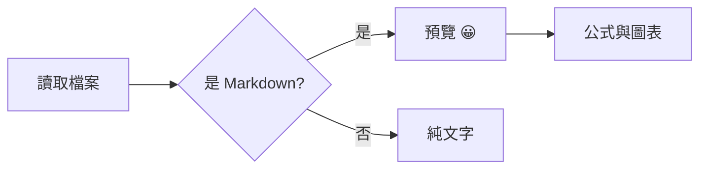

### 循序圖

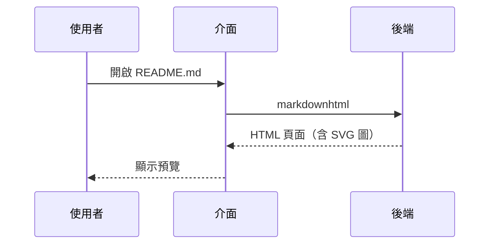

### 類別圖

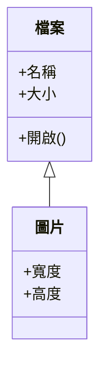

### 狀態圖

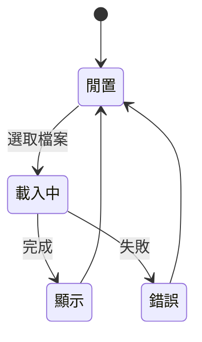

### 甘特圖

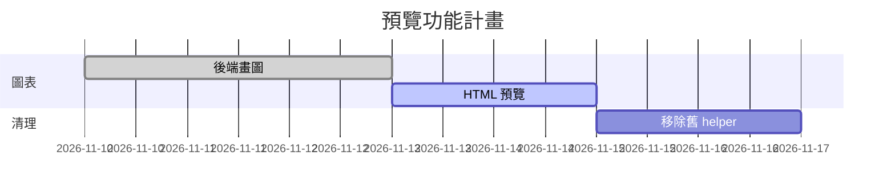

### 圓餅圖

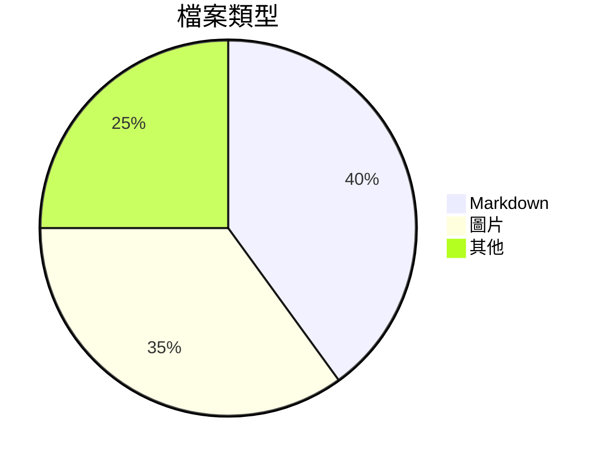

### 實體關聯圖

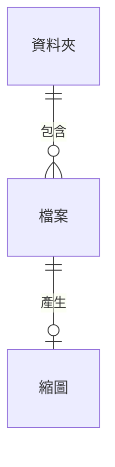

### 心智圖

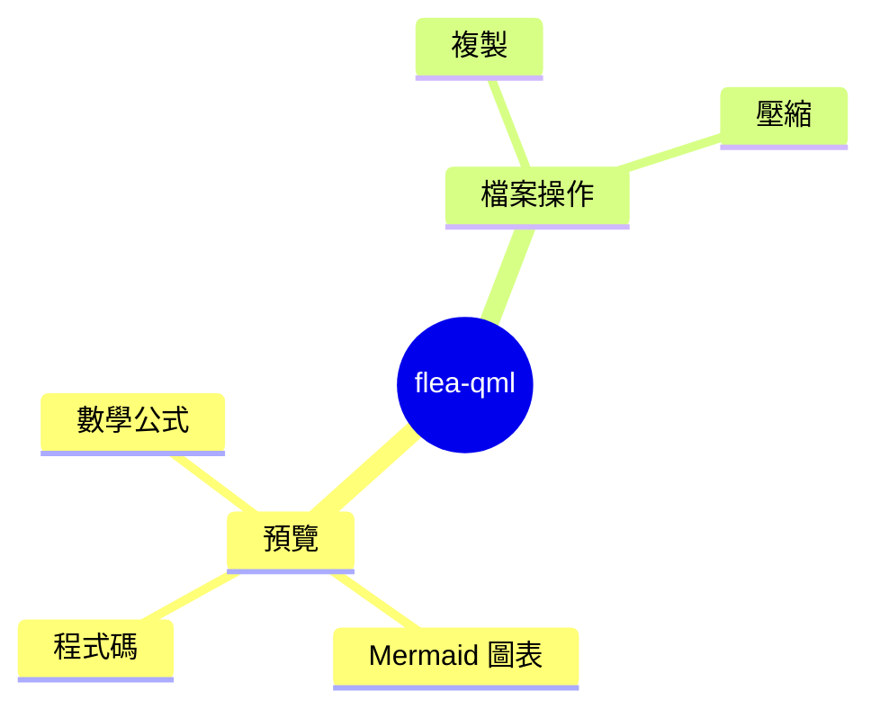

### 使用者旅程

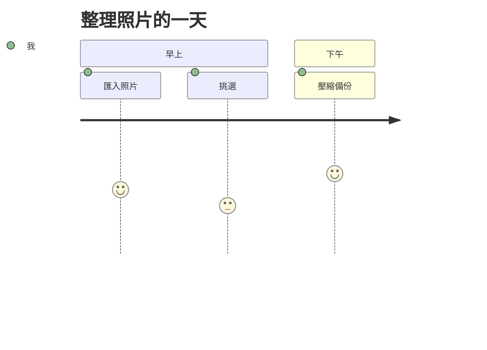

### 時間軸

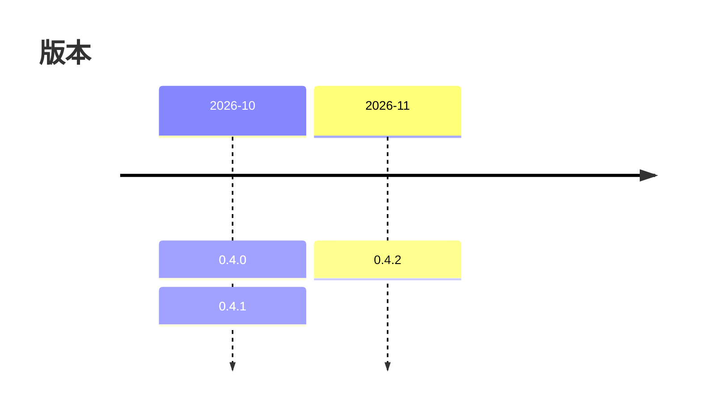

### 象限圖

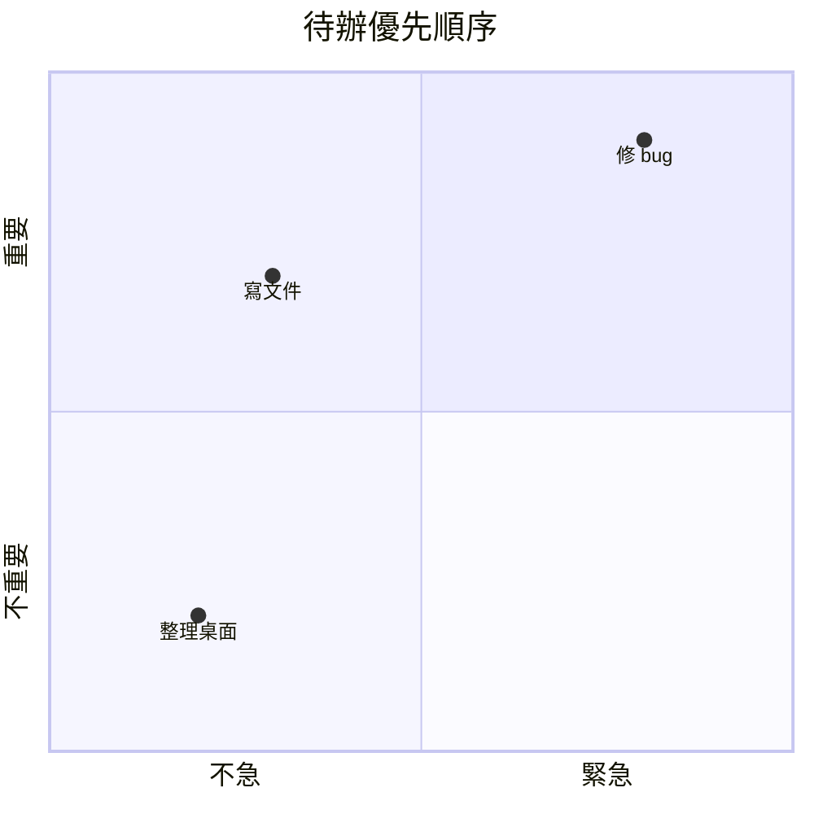

## 畫不出來時

語法錯誤的圖表會保留原始碼，下面再附一行原因：

```mermaid
flowchart TD
  A -->
```

一般的程式碼區塊不受影響：

```js
const 問候 = "這不是圖表";
```
